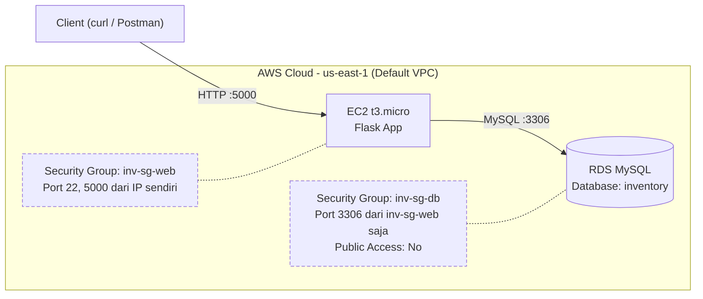

# Sistem Inventaris berbasis Cloud

Aplikasi pencatatan stok barang berbasis cloud untuk UKM, toko kecil, atau laboratorium kampus. Pengguna dapat menambah, melihat, mengubah, dan menghapus data barang melalui REST API. Proyek ini mencakup backend dan infrastruktur AWS saja, tanpa tampilan.

## Track yang Dipilih

Track C (Serverless) adalah track utama, sedangkan Track A dan B disiapkan sebagai pembanding.

| Track | Stack |
|---|---|
| A - Cloud VM | EC2 + RDS MySQL |
| B - Containers | EC2 + Docker Compose + ECR |
| C - Serverless | API Gateway + Lambda + DynamoDB |

## Entitas Data: `items`

| Atribut | Tipe | Aturan |
|---|---|---|
| id | integer auto-increment (Track A/B), UUID string (Track C) | dibuat sistem, primary key |
| name | string | wajib, 1-100 karakter |
| quantity | integer | opsional, default 0, tidak boleh negatif |
| location | string | opsional, maksimal 100 karakter |

## Endpoint CRUD

| Operasi | Method dan Path | Respons sukses |
|---|---|---|
| Create | `POST /items` | 201 + item yang dibuat |
| Read | `GET /items` | 200 + daftar item |
| Update | `PUT /items/{id}` | 200 + `{"updated": id}` |
| Delete | `DELETE /items/{id}` | 200 + `{"deleted": id}` |

Format error: `{"error": "pesan singkat"}` (400 untuk data tidak valid, 404 jika id tidak ditemukan).

## Arsitektur

## AWS Architecture Diagram

Diagram berikut menggambarkan arsitektur deployment aplikasi Flask menggunakan AWS EC2 dan RDS MySQL.

**Ringkasan alur dan keamanan**

- **Track A**
  - Alur: Client -> EC2 (Flask, :5000) -> RDS MySQL (:3306)
  - Keamanan: SG `inv-sg-web` hanya membuka port 22 dan 5000 dari IP sendiri -> SG `inv-sg-db` hanya menerima port 3306 dari `inv-sg-web` -> RDS tidak dapat diakses publik
- **Track B**
  - Alur: Developer -> build image -> ECR -> EC2 (docker pull) -> container `api` -> container `db`
  - Keamanan: SG hanya membuka port 22 dan 5000 dari IP sendiri -> port database tidak dibuka ke luar, hanya di jaringan Docker
- **Track C**
  - Alur: Client -> API Gateway (HTTPS) -> Lambda -> DynamoDB
  - Keamanan: Lambda memakai IAM role `LabRole` -> akses DynamoDB lewat role -> tidak ada kredensial di kode

#### Nama = Palupi Fitria Ningrum
#### NIM = 24/540125/TK/59904
